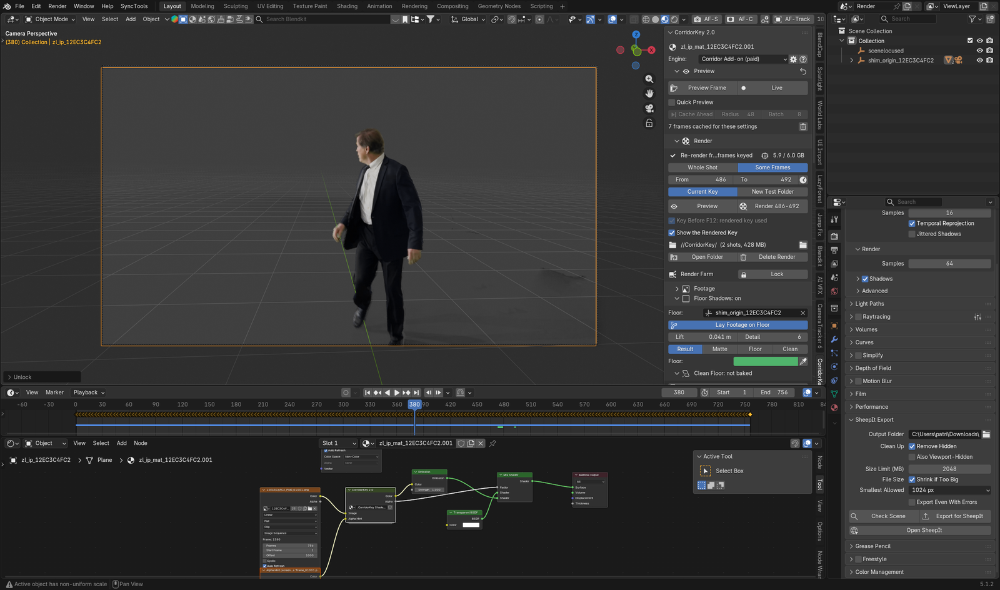
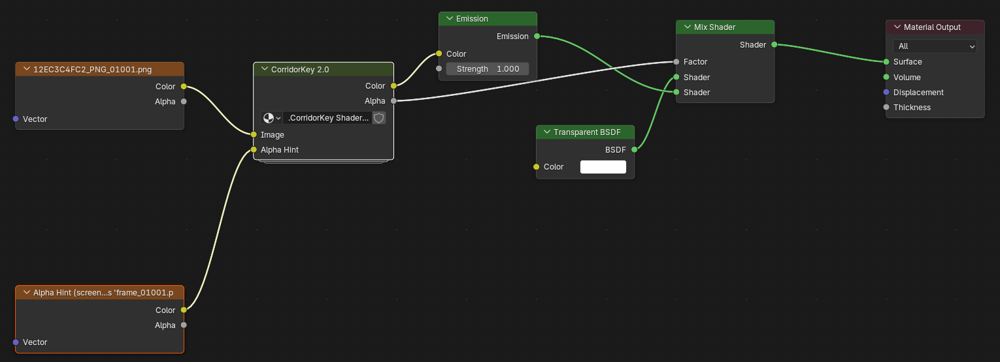
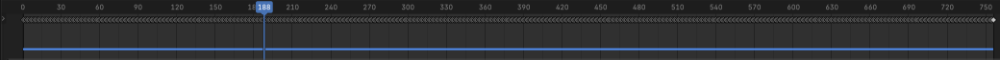
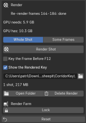
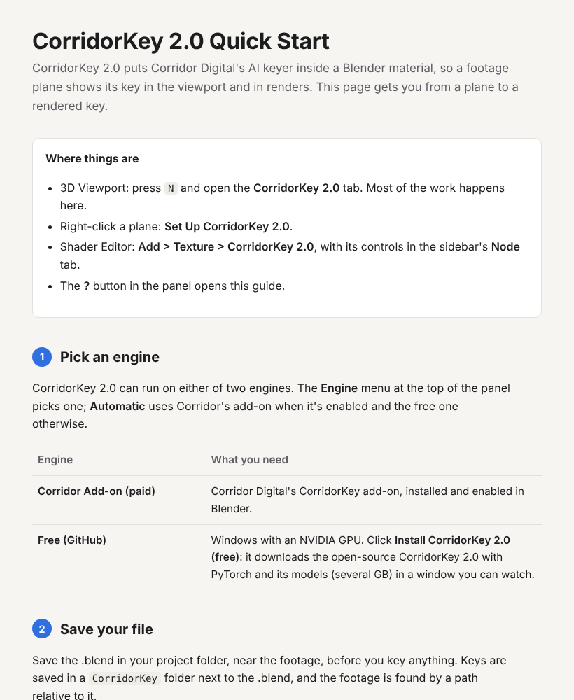

# CorridorKey 2.0 for Blender

A Blender add-on that makes Corridor Digital's CorridorKey AI keyer work as a **shader node**. A footage plane shows its key in the 3D viewport and in renders. You get live previews, a cache on the timeline, F12 keying, SAM 3 alpha hints, a green/blue screen key and render-farm locking.

> Not made by or affiliated with Corridor Digital. CorridorKey is theirs; this add-on drives either their paid Blender add-on or the free, open-source CorridorKey 2.0.

## Features

- **Shader node:** add it from **Add > Texture > CorridorKey 2.0**. It has Image and Alpha Hint inputs, and Color and Alpha outputs.

  
- **One-click Set Up:** right-click a footage plane and choose **Set Up CorridorKey 2.0**. It wires the node between the footage and the shader, and uses the plane's matte as the Alpha Hint. It also turns off a compositor key that would cover CorridorKey's (see [Jetset and Autoshot](#jetset-and-autoshot)).
- **Controls in the 3D viewport sidebar:** press N and open the **CorridorKey 2.0** tab. A Getting Started checklist covers the engine, footage, saved file and Render Folder, and warnings catch common problems: full paths, missing files, compositing.
- **Previews:**
  - Preview Frame, plus **Live**, which keys each frame you stop on.
  - **Quick Preview** for speed.
  - **Cache Ahead**, which keys frames outward from the playhead while Live is on, like After Effects.
  - The model stays loaded between previews, so later frames take about a second.
- **Progress bars** for renders, SAM 3 hints and Screen Key bakes.
- **Timeline bars:** blue for the rendered key (it grows frame by frame while a render runs), green for previews, orange for frames being keyed.

  
- **Render box:**
  - **Whole Shot**, or **Some Frames** to re-render or test a stretch, into the current key or a new test folder.
  - F12 keys the current frame first, unless that frame already shows the rendered key.
  - Delete Render.

  
- **Lock for Render Farm:** freezes the finished key into plain Blender nodes, so the material renders the same on machines without the add-on (SheepIt, farms, other computers). Unlock hands it back.
- **SAM 3 alpha hints:** type what to keep (for example `person`) and make a matte for one frame or the whole shot. SAM 3 runs only when needed: it gets the GPU while it runs and frees it when it's done.
- **Screen Key:** a simple keyer for screen that CorridorKey leaves behind. Pick the screen's colour with the eyedropper, or use the Green or Blue preset. **Clean the Key** multiplies the key's alpha by it live, inside the node. **Bake into Alpha Hint** multiplies it into your hint for every frame, so CorridorKey itself treats that screen as background. Tune it with **Show Matte**.
- **Floor Shadows:** keeps the actor's real shadows on the floor. A see-through plane covers the floor the camera sees over the whole shot. It sees the footage through the camera, so it follows every move by itself, and darkens the CG behind it where the floor is shadowed. **Bake Clean Floor** takes the lighting's falloff out first, so only real shadows darken (technique credit: see [Credits](#credits)). Matte controls: views, levels, blur, gate, tint, floor and frame crops, fades, shape editing.
- **Lay Footage on Floor:** where the footage plane would dip below the floor (Jetset's shim origin), it's laid onto the floor along the camera's sight lines. Same picture from the camera, no plane through the virtual floor.
- **Two engines:**
  - **Corridor Add-on (paid):** Corridor Digital's CorridorKey add-on for Blender.
  - **Free (GitHub):** [CorridorKey 2.0](https://github.com/nikopueringer/CorridorKey2.0), with a one-click installer (Windows, NVIDIA GPU).

## Jetset and Autoshot

The add-on is made for the Blender scenes that Autoshot builds from Jetset takes (both by [Lightcraft](https://lightcraft.pro/); see their [Blender round-trip guide](https://docs.lightcraft.pro/tutorials/blender-workflows/autoshot-blender-round-trip)). Open the .blend Autoshot made, select the image plane, right-click it and choose **Set Up CorridorKey 2.0**. That is the whole hookup; the rest of this section is what happens to each part of Autoshot's scene.

| Autoshot's scene | What CorridorKey 2.0 does with it |
| --- | --- |
| The image plane (`zl_ip_…`) showing the camera-original plate | **Set Up** puts the CorridorKey 2.0 node between the plate and the plane's shader. The plane then shows CorridorKey's key in the viewport and in renders, on the tracked camera, with no compositing step. |
| Jetset's AI matte, a greyscale image sequence on the plane | **Set Up** recognises it by name and plugs it into the node's **Alpha Hint**, so CorridorKey knows roughly what to keep. With no matte, it can make one with SAM 3. |
| Image sequences numbered from 1001 (frame offset 1000) | The node follows the footage's **Start Frame** and **Offset**, so previews, the rendered key and the timeline bars line up with the scene's frames. |
| Autoshot's compositor (the Autoshot node group, once called Zipline), which keys the plate again and lays it over the render | It would cover CorridorKey's key in renders, so **Set Up** turns compositing off. If compositing is on again, the panel says so and offers **Turn Off Compositing**. |
| The tracked camera, parented to the shim (`shim_origin_…`) | **Floor Shadows** takes the shim as the floor (the camera's top parent), so the shadow plane sits on Jetset's floor and follows the camera's moves, zooms and lens shift. **Lay Footage on Floor** keeps the image plane from dipping below that floor. |
| The take's folder, with the .blend in it | Keys and previews are saved in folders next to the .blend, with relative paths, so the take folder can move. **Lock for Render Farm** freezes the finished key into plain nodes for render farms such as SheepIt. |

A few things to set in Autoshot:

- **Export the plate as an image sequence (EXR or PNG), not a movie.** CorridorKey keys frames from a sequence, and Jetset's AI roto needs EXR or PNG media too.
- **Turn on the AI matte** if you want it as the Alpha Hint. It's optional: CorridorKey keys without one, and **Set Up** can make one with SAM 3.
- **Key in the .blend Autoshot saved in the take folder** (or save yours before keying), so keys land next to it with relative paths.

> Jetset and Autoshot are Lightcraft Technology's. This add-on is not made by or affiliated with Lightcraft.

## Requirements

- Blender 5.0 or later
- An NVIDIA GPU for the free engine and SAM 3 (Windows, or Linux with a manual setup)
- One of the two engines above

## Install

1. Download the add-on zip from [`dist/`](dist), for example `CorridorKey_2.0-v2.22.0.zip`. Use that file rather than GitHub's **Code > Download ZIP**, which also packs the README and license. Or zip the add-on files yourself: `__init__.py`, `free_server.py`, `sam3_worker.py`, `screen_key_worker.py`, `blender_manifest.toml`, `QUICKSTART.html`.
2. In Blender, go to **Edit > Preferences > Get Extensions**, open the menu at the top right, and choose **Install from Disk...** with that zip.
3. Open the 3D viewport sidebar (N), then the **CorridorKey 2.0** tab, and click **?** for the quick-start guide.

**Updating:** in **Edit > Preferences > Add-ons > CorridorKey 2.0**, the **Updates** box checks this repository for a newer version (also once when Blender starts) and **Update** downloads it and reloads the add-on, with no restart. A newer version also shows an **Update** button at the top of the sidebar. (The **GitHub Token** field is only needed if the repository is ever made private again: a fine-grained token for it with **Contents: Read-only**.) Blender's **Allow Online Access** (Preferences > System) must be on.

## Files

| File | What it is |
| --- | --- |
| `__init__.py` | The add-on: the node, panels, previews, renders, locking, SAM 3 hints |
| `free_server.py` | Worker that runs the free CorridorKey 2.0 engine with its own Python |
| `sam3_worker.py` | Worker that runs SAM 3 for alpha hints with its own Python |
| `screen_key_worker.py` | Worker that bakes the screen key into the Alpha Hint, in a background Blender |
| `QUICKSTART.html` | The quick-start guide the **?** button opens |
| `blender_manifest.toml` | Blender extension manifest |
| `dist/` | Ready-to-install add-on zips, one per version |
| `docs/images/` | The pictures in this README |

## Credits

- **Floor Shadows** follows the shadow-keeping technique in ActionVFX's tutorial [How To Retain Green Screen Shadows and Fine Details | After Effects Tutorial](https://www.youtube.com/watch?v=T8FSeBRx6Rc): key the shadows separately from the subject, then multiply them over the new background. This add-on does the same in Blender, on a plane on the floor.

## Third-party software

- **CorridorKey** is by Corridor Digital. The free engine is [nikopueringer/CorridorKey2.0](https://github.com/nikopueringer/CorridorKey2.0), installed separately into its own folder.
- **SAM 3** is by Meta ([facebookresearch/sam3](https://github.com/facebookresearch/sam3)), under the SAM License. The installer downloads it, with its weights, from an ungated mirror ([cubert-gmbh/sam3](https://huggingface.co/cubert-gmbh/sam3)). Neither is included in this repository.

## License

GPL-3.0-or-later. See [LICENSE](LICENSE).
